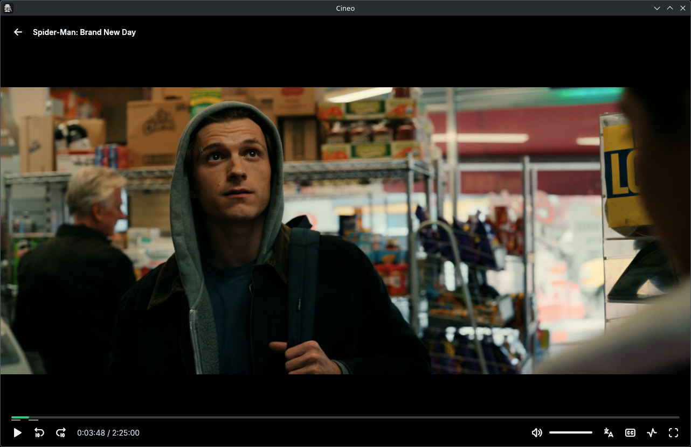

# Cineo

[](https://github.com/mdmrk/cineo/actions/workflows/ci.yml)
[](https://github.com/mdmrk/cineo/releases/latest)
[](https://github.com/mdmrk/cineo/releases)
[](docs/COMPATIBILITY.md#platforms)
[](LICENSE)

A fast, native desktop media center written in Rust. It works with
Stremio-protocol addons.

<table>
  <tr>
    <td></td>
    <td></td>
  </tr>
  <tr>
    <td></td>
    <td></td>
  </tr>
</table>

[Features](#features) · [Install](#install) ·
[Build from source](#build-from-source) ·
[Documentation](#documentation) · [License](#license)

## Features

- Stremio addons, catalogs and search
- Built-in player with torrent streaming
- Subtitles, binge watching and a local library
- No account, no cloud

## Install

Run the same command again to update. Executables for every release are on
the [Releases](https://github.com/mdmrk/cineo/releases) page.

### Linux (x86_64)

```sh
curl -fsSL https://github.com/mdmrk/cineo/releases/latest/download/install.sh | sh
```

Cineo needs libmpv: install your distribution's mpv package. To
uninstall, add `-s -- --uninstall` after `sh`.

### Windows (x86_64)

In PowerShell:

```powershell
irm https://github.com/mdmrk/cineo/releases/latest/download/install.ps1 | iex
```

libmpv is built in. To uninstall, set `$env:CINEO_UNINSTALL=1` first.

## Build from source

You need [Rust](https://rustup.rs) and libmpv.

```sh
git clone https://github.com/mdmrk/cineo && cd cineo
cargo run -p cineo-desktop --release
```

On Windows, put a `libmpv-2.dll` next to the executable
([details](docs/DEVELOPMENT.md)). A
[command-line tool](docs/DEVELOPMENT.md#command-line-tool) is also
included, mainly for debugging addons.

## Documentation

| Document | Contents |
|----------|----------|
| [Compatibility](docs/COMPATIBILITY.md) | What works, per feature and platform |
| [Addon protocol](docs/ADDON_PROTOCOL.md) | How Cineo reads Stremio addons |
| [Architecture](docs/ARCHITECTURE.md) | Crates, data flow and platform code |
| [Development](docs/DEVELOPMENT.md) | Building, testing and releasing |
| [Security](docs/SECURITY.md) | Threat model and defaults |
| [Technical debt](docs/TECHNICAL_DEBT.md) | Known limitations |
| [Decisions](docs/adr/README.md) | Architecture decision records |

## License

[MIT](LICENSE). Cineo is not affiliated with Stremio. It ships no content
and no content addons. See [Legal](docs/LEGAL.md).
