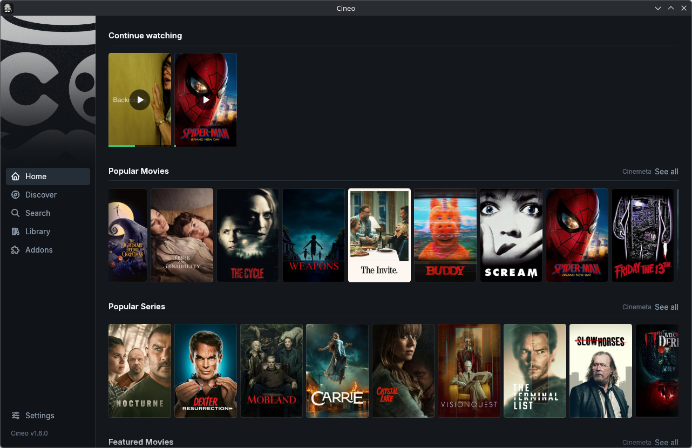
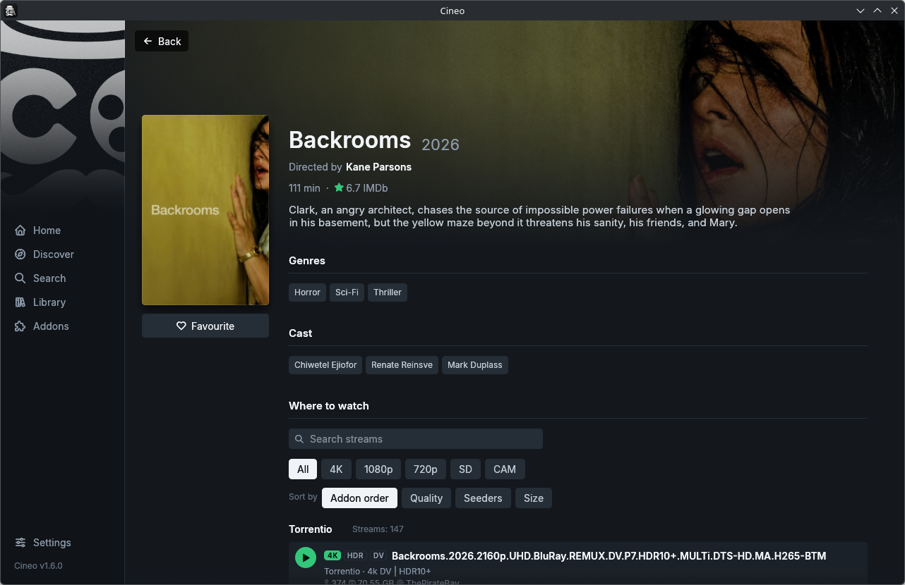
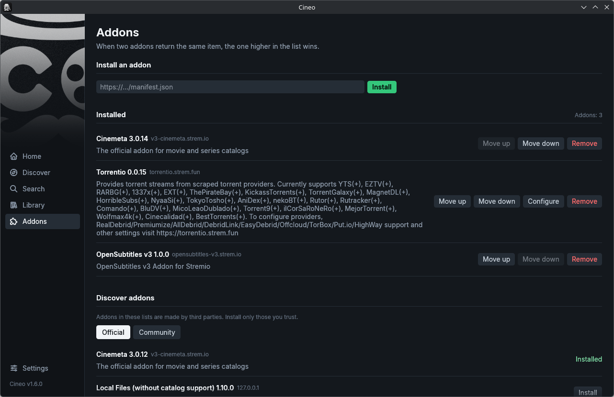
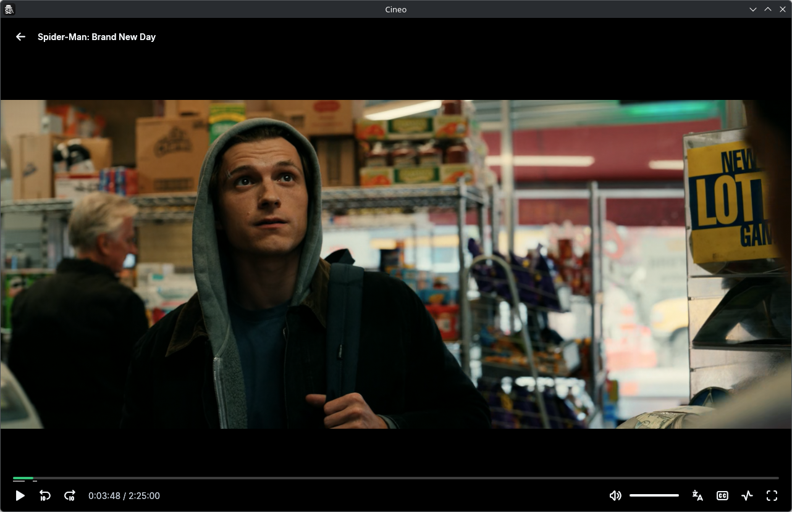
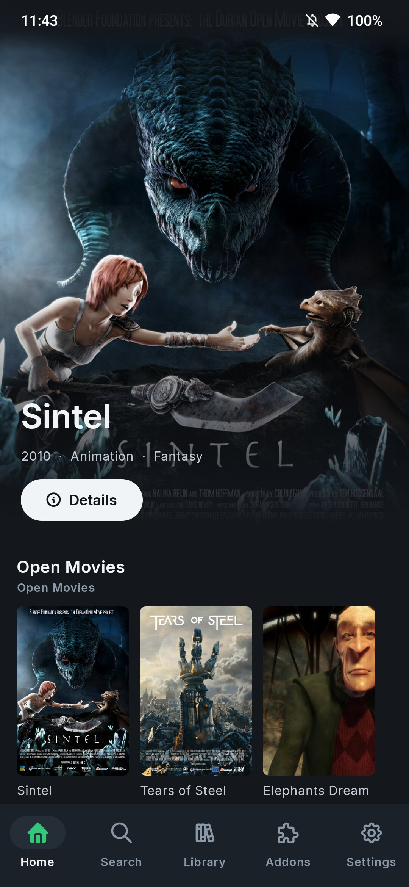
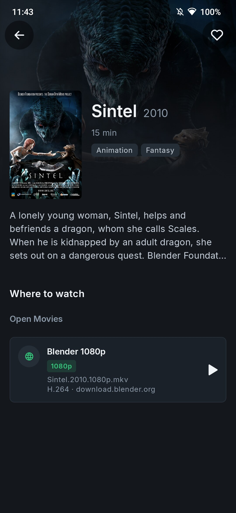
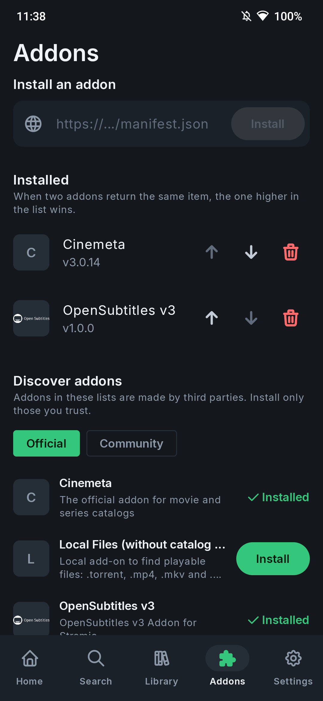
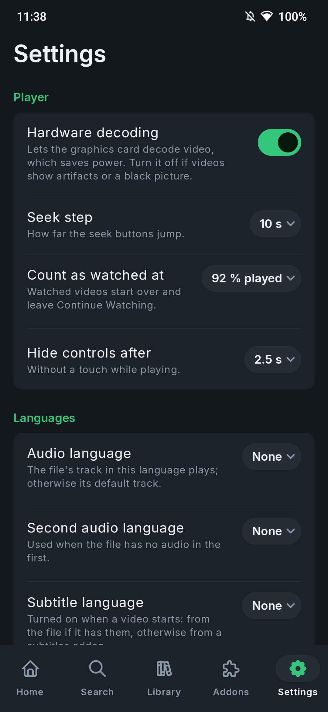

# Cineo

[](https://github.com/mdmrk/cineo/releases/latest)
[](docs/COMPATIBILITY.md#platforms)
[](LICENSE)

A fast, native media center for Linux, Windows, macOS and Android phones.
It works with Stremio addons. No account, no cloud.

<table>
  <tr>
    <td></td>
    <td></td>
  </tr>
  <tr>
    <td></td>
    <td></td>
  </tr>
</table>

<table>
  <tr>
    <td></td>
    <td></td>
    <td></td>
    <td></td>
  </tr>
</table>

## Contents

- [Features](#features)
- [Install](#install)
  - [Linux](#linux-x86_64)
  - [Windows](#windows-x86_64)
  - [macOS](#macos-apple-silicon-and-intel-macos-11-or-newer)
  - [Android](#android-arm64-phones)
- [Update](#update)
- [Uninstall](#uninstall)
- [For developers](#for-developers)
- [License](#license)

## Features

- Stremio addons, catalogs and search
- Built-in player with torrent streaming
- Subtitles, binge watching and a local library
- Everything stays on your device

## Install

### Linux (x86_64)

Install your distribution's **mpv** package first, then run:

```sh
curl -fsSL https://github.com/mdmrk/cineo/releases/latest/download/install.sh | sh
```

### Windows (x86_64)

In PowerShell:

```powershell
irm https://github.com/mdmrk/cineo/releases/latest/download/install.ps1 | iex
```

Nothing else is needed.

### macOS (Apple silicon and Intel, macOS 11 or newer)

Download `cineo-universal-macos.dmg` from the
[latest release](https://github.com/mdmrk/cineo/releases/latest), open it
and drag Cineo to Applications. The app is not notarized, so macOS blocks
it the first time: open **System Settings → Privacy & Security** and
click **Open Anyway**, or run
`xattr -dr com.apple.quarantine /Applications/Cineo.app`.

### Android (arm64 phones)

Download and open `cineo-arm64-android.apk` from the
[latest release](https://github.com/mdmrk/cineo/releases/latest).

## Update

Run the install command again. On macOS, replace Cineo in Applications
with the new one. On Android, install the new APK over the old one.

## Uninstall

Linux:

```sh
curl -fsSL https://github.com/mdmrk/cineo/releases/latest/download/install.sh | sh -s -- --uninstall
```

Windows (PowerShell):

```powershell
$env:CINEO_UNINSTALL=1; irm https://github.com/mdmrk/cineo/releases/latest/download/install.ps1 | iex
```

Your addons and library are kept. To remove them too, delete
`~/.local/state/cineo` (Linux) or `%LOCALAPPDATA%\Cineo\data` (Windows).

On macOS, move Cineo from Applications to the Trash. Your addons and
library stay in `~/Library/Application Support/Cineo`.

On Android, uninstall Cineo like any other app. This also deletes your
addons and library.

## For developers

```sh
git clone https://github.com/mdmrk/cineo && cd cineo
cargo run -p cineo-desktop --release
```

You need [Rust](https://rustup.rs) and libmpv. Windows and Android builds
are covered in [Development](docs/DEVELOPMENT.md). See also
[Architecture](docs/ARCHITECTURE.md), the
[addon protocol](docs/ADDON_PROTOCOL.md), [Security](docs/SECURITY.md),
[known limitations](docs/TECHNICAL_DEBT.md) and the
[decision records](docs/adr/README.md).

## License

[MIT](LICENSE). Cineo is not affiliated with Stremio and ships no content
or content addons. See [Legal](docs/LEGAL.md).
