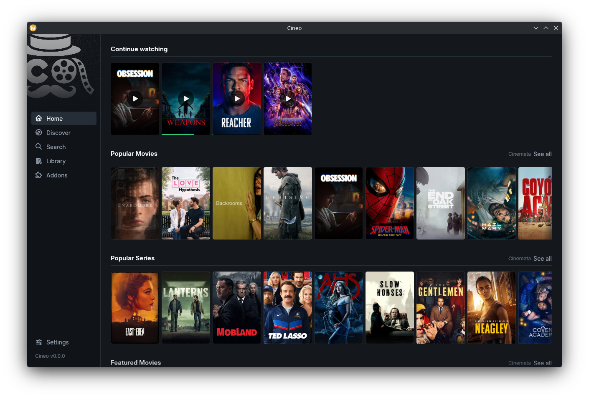
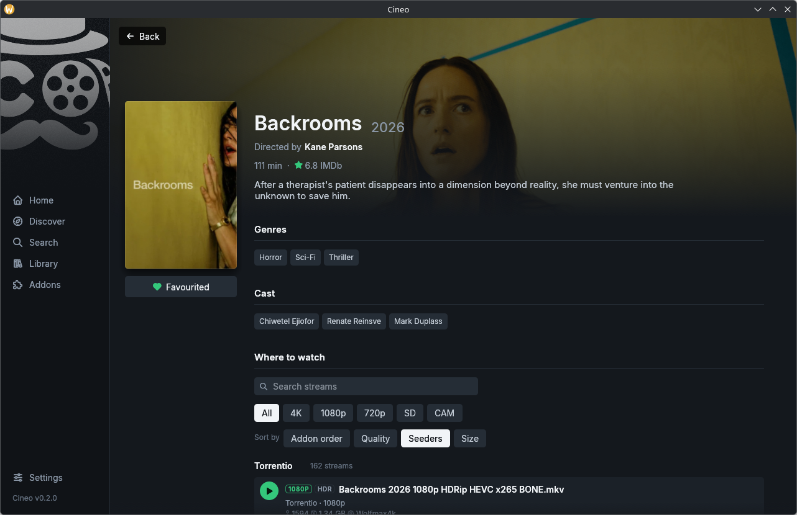
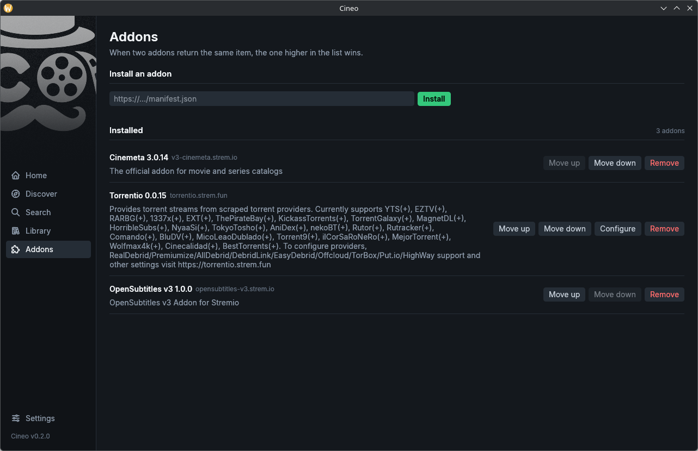
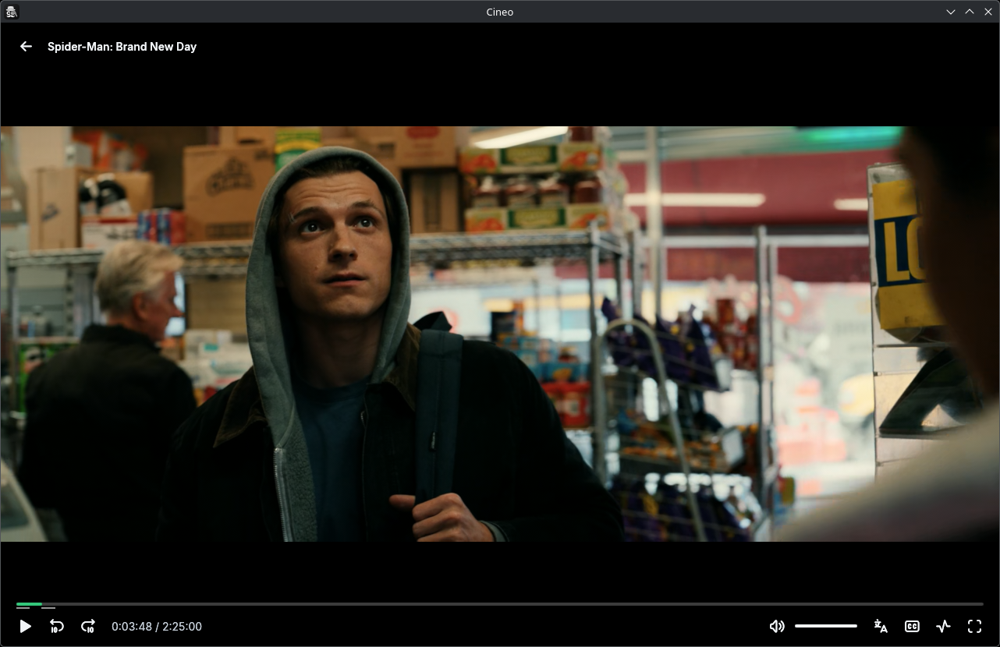

# Cineo

A fast, native desktop media center written in Rust. It works with
Stremio-protocol addons.

<table>
  <tr>
    <td></td>
    <td></td>
  </tr>
  <tr>
    <td></td>
    <td></td>
  </tr>
</table>

## Features

- Install addons by URL
- Browse catalogs, search and view details
- Play streams in the app window, including torrents
- Torrents stream from memory by default, holding only the part around
  the playback position (1 GB, adjustable), so nothing is written to disk
- Continue watching and a local library
- No account and no cloud

Runs on Linux, Windows and macOS.

## Install

Cineo is one executable. Install it for your user with:

- **Linux (x86_64):**
  ```sh
  curl -fsSL https://github.com/mdmrk/cineo/releases/latest/download/install.sh | sh
  ```
  It goes to `~/.local/bin/cineo-desktop`, with an app-menu entry. Video
  plays with your system's libmpv; the installer says which package to
  install if it is missing (`mpv` on Arch, `libmpv2` on Debian/Ubuntu,
  `mpv-libs` on Fedora).
- **Windows (x86_64), in PowerShell:**
  ```powershell
  irm https://github.com/mdmrk/cineo/releases/latest/download/install.ps1 | iex
  ```
  It goes to `%LOCALAPPDATA%\Programs\Cineo`, with a Start menu entry.
  libmpv is included. The executable is not signed yet, so SmartScreen may
  warn on first start.

Both scripts check the download against the release's `SHA256SUMS`. To
remove Cineo, run the Linux script with `sh -s -- --uninstall`, or set
`$env:CINEO_UNINSTALL = 1` before the PowerShell one; your addons and
library are kept.

Without a script: download `cineo-x86_64-linux` or
`cineo-x86_64-windows.exe` from
[Releases](https://github.com/mdmrk/cineo/releases) and run it. On macOS,
download `cineo-aarch64-macos.tar.gz` and install mpv (`brew install mpv`).

## Run from source

You need Rust and libmpv (see above).

```sh
git clone https://github.com/mdmrk/cineo && cd cineo
cargo run -p cineo-desktop --release
```

A [command-line tool](docs/DEVELOPMENT.md#command-line-tool) is also
included, mainly for debugging addons.

## Learn more

- [What works](docs/COMPATIBILITY.md)
- [Roadmap](docs/ROADMAP.md)
- [Architecture](docs/ARCHITECTURE.md)
- [Development](docs/DEVELOPMENT.md)
- [Security](docs/SECURITY.md)

## License

[MIT](LICENSE). Cineo is not affiliated with Stremio. It ships no content
and no content addons. See [Legal](docs/LEGAL.md).
