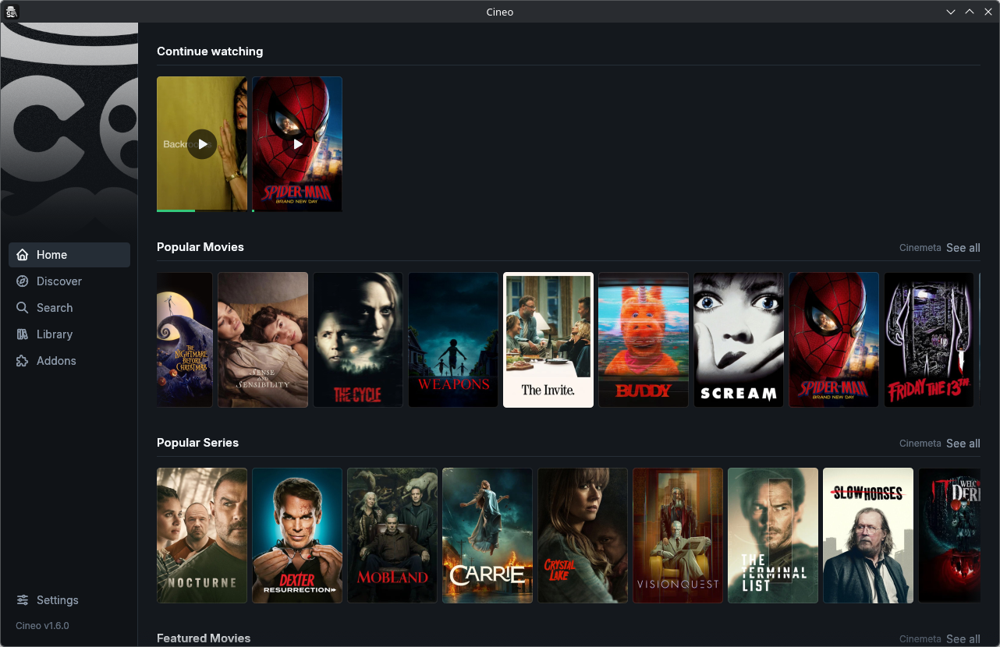
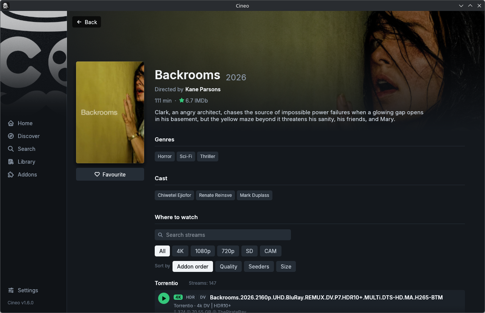
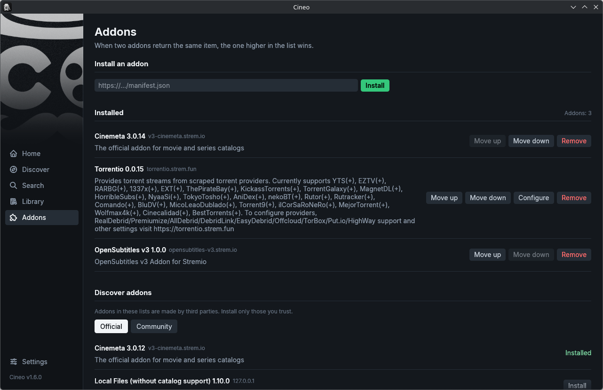
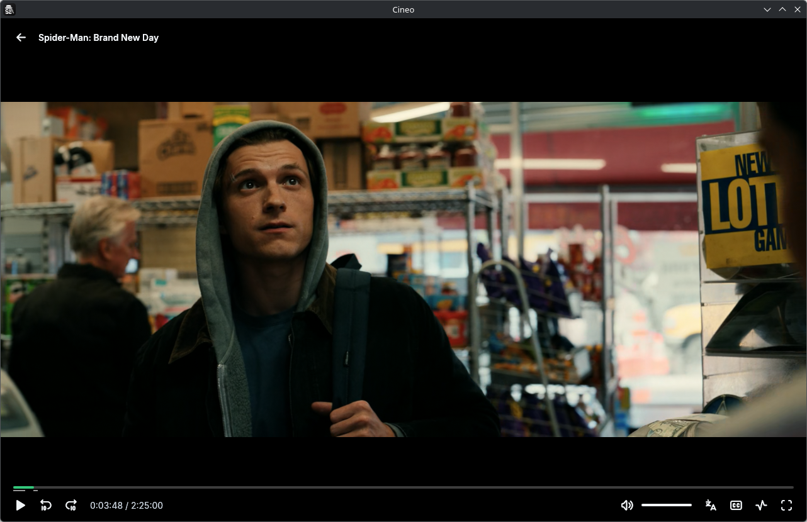
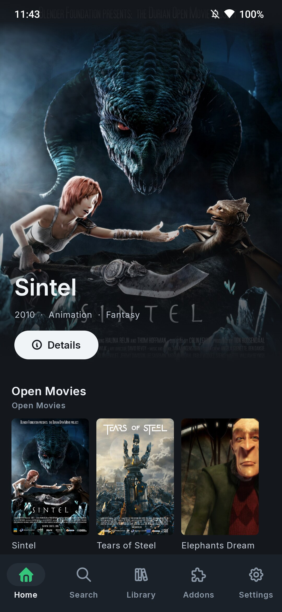
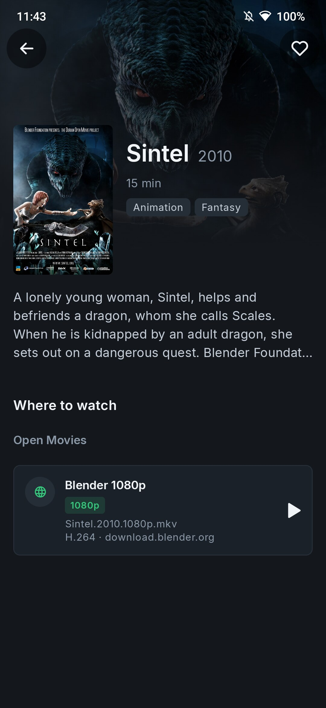
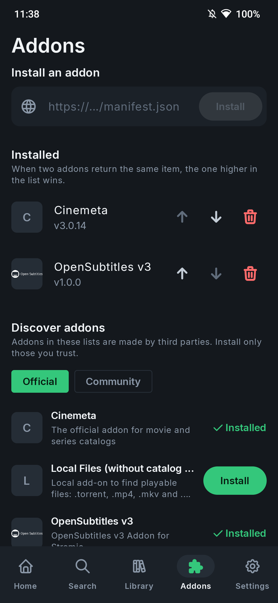
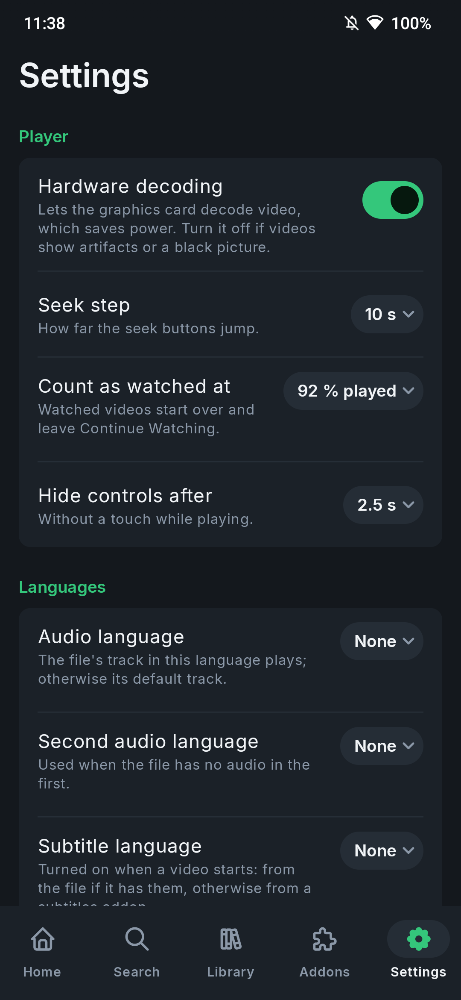

# Cineo

[](https://github.com/mdmrk/cineo/releases/latest)
[](docs/COMPATIBILITY.md#platforms)
[](LICENSE)

A fast, native media center for Linux, Windows, macOS and Android phones.
It works with Stremio addons. No account, no cloud.

[Install](#install) · [Uninstall](#uninstall) · [Build](#build) · [License](#license)

<table>
  <tr>
    <td></td>
    <td></td>
  </tr>
  <tr>
    <td></td>
    <td></td>
  </tr>
</table>

<table>
  <tr>
    <td></td>
    <td></td>
    <td></td>
    <td></td>
  </tr>
</table>

## Install

Linux (needs mpv):

```sh
curl -fsSL https://github.com/mdmrk/cineo/releases/latest/download/install.sh | sh
```

Windows:

```powershell
irm https://github.com/mdmrk/cineo/releases/latest/download/install.ps1 | iex
```

macOS and Android: [latest release](https://github.com/mdmrk/cineo/releases/latest).

## Uninstall

Linux:

```sh
curl -fsSL https://github.com/mdmrk/cineo/releases/latest/download/install.sh | sh -s -- --uninstall
```

Windows:

```powershell
$env:CINEO_UNINSTALL = 1; irm https://github.com/mdmrk/cineo/releases/latest/download/install.ps1 | iex
```

macOS: drag Cineo from Applications to the Trash.

Android: uninstall it like any other app. This also removes its data.

On the desktop, your addons and library are kept. To remove them too, delete:

| Platform | Folders |
| --- | --- |
| Linux | `~/.local/state/cineo`, `~/.cache/cineo` |
| Windows | `%LOCALAPPDATA%\Cineo` |
| macOS | `~/Library/Application Support/Cineo`, `~/Library/Caches/Cineo` |

## Build

```sh
cargo run --release
```

Needs Rust and libmpv. See [Development](docs/DEVELOPMENT.md).

## License

[MIT](LICENSE). Not affiliated with Stremio.
