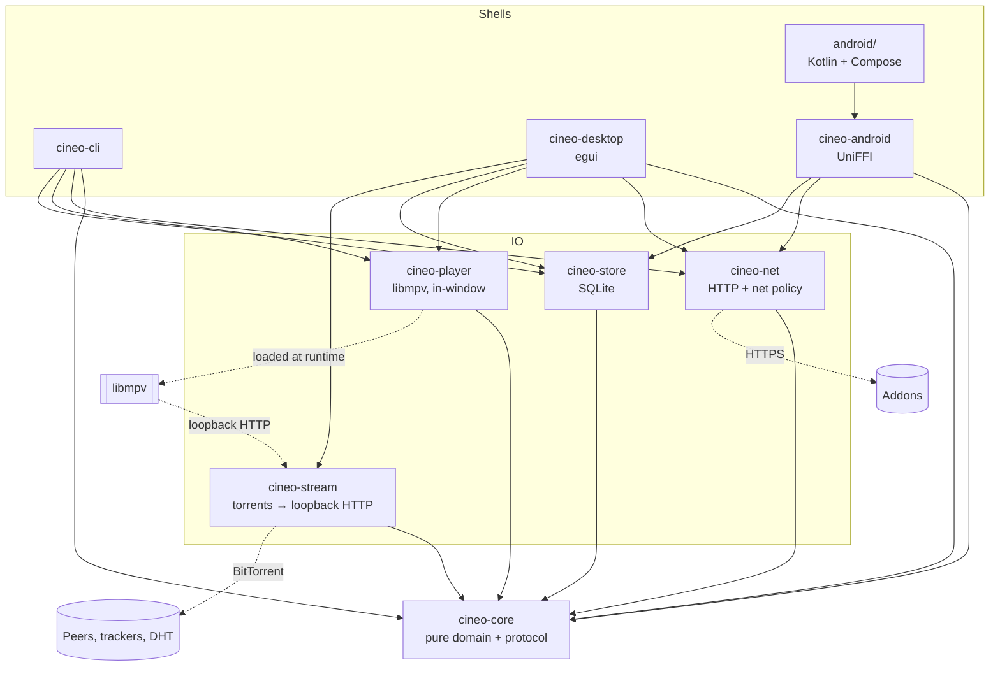
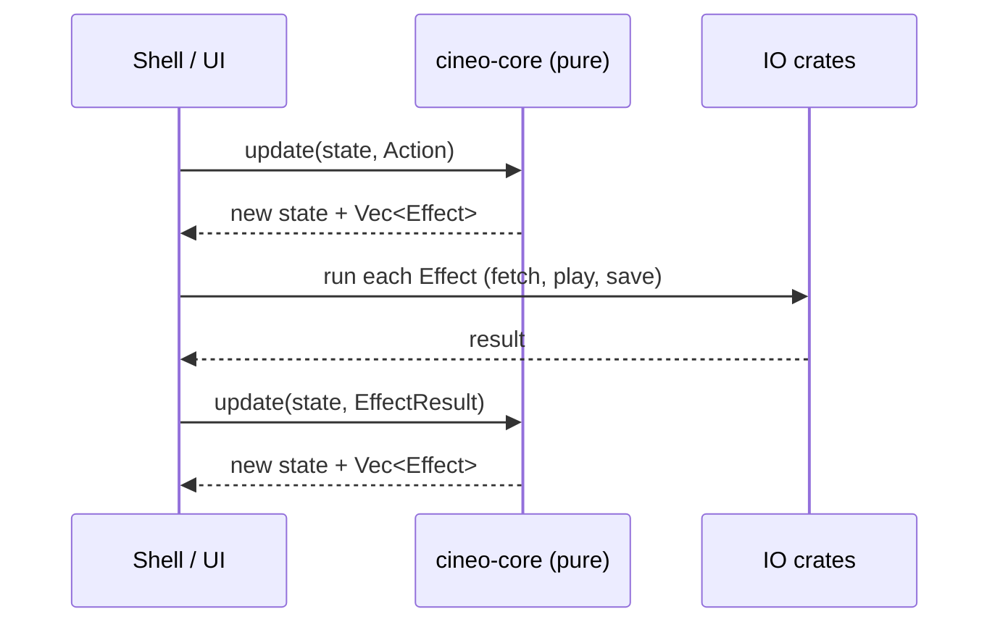

# Architecture

Decisions are recorded in [adr/](adr/README.md). Cineo runs on Linux
x86_64 and Windows x86_64 (ADR-0022, ADR-0027). An Android port for
arm64, with a Kotlin UI over a Rust shell crate, is in progress
(ADR-0028); each release carries its APK (ADR-0029).

## System overview

Cineo follows a **functional core, imperative shell** design (ADR-0001):

- **`cineo-core`** is pure. It holds domain types, addon-protocol parsing and
  validation, request planning, and state reducers. It does no IO, has no
  async and no clock, so it can be tested exhaustively and quickly.
- **IO crates** perform effects described by the core. These are HTTP, the
  player (libmpv), storage and the streaming engine, and each has its own
  safety policy.
- **Shells** wire everything together and present state: the desktop GUI,
  and a CLI for debugging addons.

## Dependency direction

`shells → IO crates → core`. Never the reverse.

- `cineo-core` depends on no other workspace crate, no async runtime, no
  HTTP or UI library.
- IO crates depend on `cineo-core` and their own libraries (reqwest, rusqlite).
  They do not depend on each other.
- Only shells depend on several IO crates and decide policy, for example
  whether private networks are allowed.

## Crate boundaries (ADR-0002)

| Crate | Responsibility |
|-------|---------------|
| `cineo-core` | Protocol model (wire → domain), validation, filtering, URL building, aggregation, library/progress model, reducers |
| `cineo-net` | `AddonClient`: fetch with timeouts, size caps, SSRF-safe resolver and redirect policy |
| `cineo-cli` | Headless shell; debugging tool |
| `cineo-player` | Load libmpv at runtime, draw video into the window; typed commands, status and events (ADR-0014) |
| `cineo-store` | Persistence (installed addons, library, progress, settings) with migrations |
| `cineo-desktop` | GUI shell: eframe/egui, custom theme, images via `cineo-net` |
| `cineo-stream` | Local streaming engine: torrent sources → loopback HTTP URL (ADR-0010); `Torrents` runs the start, stop, status and lookahead steps for both shells |
| `cineo-android` | Rust half of the Android shell (ADR-0028): holds the core `State`, runs effects through the IO crates, and hands Kotlin `AppView` snapshots through UniFFI; the TLS verifier's JNI entry point |

**When to add a crate:** only when the new code has a different dependency
set or a different IO boundary from an existing crate. A new *concept* is a
module, not a crate. The addon protocol stays a module of `cineo-core` until a
second consumer needs it standalone (for example an addon SDK).

## Boundaries

### Addon boundary

Addon data is untrusted. It is parsed in two steps (ADR-0003):

1. **Wire level, lenient.** JSON is walked field by field. A bad optional
   field becomes "absent" and produces a `Warning`. A bad array element is
   skipped with a `Warning`. Only missing required invariants (for example
   the manifest `id` or `version`) are errors.
2. **Domain level, strict.** The domain types (`Manifest`, `Resource`,
   `CatalogDef`, `MetaPreview`, …) carry invariants such as non-empty ids,
   `http(s)`-only image URLs and resolved inheritance. Code past the parser
   never re-validates.

Warnings are returned next to the value (`Parsed<T>`), and shells log them.
This keeps "the addon sent garbage" observable without failing the whole
response.

### Networking boundary

All HTTP goes through `cineo-net`'s `AddonClient`, which enforces `NetPolicy`
([SECURITY.md](SECURITY.md)). The core only builds `Url`s; it never fetches.
The update check is one more request through the same client: the core asks
for it with `Effect::CheckForUpdate` and compares the version it gets back.

### Player boundary (ADR-0014)

The core's `Effect::Play(PlayRequest)` starts playback. `cineo-player`
(`embedded::Player`) loads libmpv at runtime, and libmpv draws into the
desktop window through the OpenGL render API. The desktop shell draws the
video in an egui paint callback over the whole window and its own controls
on top (`cineo-desktop/src/player.rs`). The controls send typed
`PlayerCommand`s; a `Status` snapshot (position, pause, volume, tracks)
feeds them. Without libmpv, playback fails with a message saying so.
`cineo-player` looks for `libmpv.so.2` and `libmpv.so` in the executable's
directory first, then on the system library path.

mpv's events become `PlayerEvent`s (`Progress`, `Ended`, `Failed`,
`Closed`) through a small state machine (`tracker`), which the shell turns
into core actions. Shells never send raw mpv commands or options.
Untrusted strings never become mpv options.

### Persistence boundary

`cineo-store` stores domain values (installed addons with their order,
library items, progress). The core defines what is stored: the
`SaveAddons`, `SaveLibraryItem` and `DeleteLibraryItem` effects, which
`Store::apply` executes. The store defines how: one SQLite file, the schema
version in `PRAGMA user_version`, append-only migrations run in one
transaction, and a fixture per released schema (`tests/store/`). After
migrating, the file uses write-ahead logging with `synchronous = NORMAL`
(`file_databases_use_write_ahead_logging`): a commit does not wait for
an fsync, and a power loss can drop the last commits but not corrupt the
file.
The API is blocking; async shells call it off the runtime's worker threads.

### UI boundary (ADR-0011)

The UI renders **state snapshots** and sends **actions**. It holds no business
logic. That keeps the GUI technology replaceable and lets the CLI exercise
exactly the same core paths.

In `cineo-desktop`:
- `view::show(ui, &State, &mut ViewState) -> Vec<Action>` is pure rendering.
  `ViewState` holds presentation only (open page, text being typed). The UI
  tests drive this function headlessly with `egui_kittest`.
- `app::CineoApp` is the shell. Before each frame it drains a channel of IO
  results and dispatches them. Fetches and playback run on a tokio runtime.
  Store writes go, in order, to one thread, which is joined on exit so the
  last progress write lands. Queued writes that a later one overwrites
  (settings, the addon list, a library item by id) are dropped
  (`queued_saves_keep_only_the_last_write_of_each_key`). mpv events become
  `PlaybackProgress` actions.
- Images: `images::NetImageLoader` (an egui `ImageLoader`) fetches through
  `cineo-net`, then decodes and downscales on the tokio blocking pool, at
  most one image per CPU core at a time.
- Text (ADR-0017, ADR-0021): `rust-i18n` embeds the
  `assets/locales/*.toml` catalogs at compile time, and `i18n::t!` looks
  messages up in the thread-local locale. The locale is set from the
  `ui_language` setting every frame. Core returns `Problem` and `Notice` values, never prose.

### Platform integration

Linux and Windows (ADR-0022, ADR-0027). Platform code sits behind `cfg`
in the crate that does the IO:

| Concern | Linux | Windows |
|---------|-------|---------|
| Data and cache directories (`cineo-store`) | XDG | `%APPDATA%\Cineo\data`, `%LOCALAPPDATA%\Cineo\cache` |
| Private files (`cineo-store`, `cineo-stream`, desktop subtitles) | mode 0700/0600 | the profile's default ACL |
| Torrent piece IO (`cineo-stream`) | `read_at`/`write_all_at` | `seek_read`/`seek_write` |
| libmpv (`cineo-player`) | system `libmpv.so.2` | `libmpv-2.dll` embedded in the release and written to the cache (`bundled-libmpv`) |
| Single-instance handover (desktop `instance`) | Unix socket | named pipe |
| Scheme registration (desktop `register`) | `xdg-mime` | `HKCU` via `reg.exe` |
| Media keys (desktop `media_keys`) | MPRIS over `zbus` | SMTC via `souvlaki` |
| Keep awake (desktop `keep_awake`) | `org.freedesktop.ScreenSaver` | `SetThreadExecutionState` via `keepawake` |

`std::os::unix` and `std::os::windows` need a `cfg`.

On Android (ADR-0028) the UI is Kotlin and Compose in `android/`.
`cineo-android` runs `update` and the effects on its own `shell` thread,
the way `cineo-desktop` does on its UI thread, and after each batch of
messages hands Kotlin an `AppView` (only when it changed) through a
`StateListener` that Kotlin implements. Kotlin calls methods such as
`installAddon` that become `Action`s, and words the typed problems and
notices itself (ADR-0017). While the player or the torrent connecting
screen is up, the `AppView` leaves out the addons, catalogs, library and
detail those screens do not draw, so the torrent's status each second does
not carry them across. Images come through `Cineo.fetchImage`, so they
use `cineo-net` and its limits like every other request. The network
effects (`cineo_net::fetch_task`) and the store's writer thread
(`cineo_store::spawn_writer`) are shared with the desktop.

## State model and data flow

The state model follows the stremio-core idea of unidirectional flow, but
simplified (ADR-0001):

- `Effect` is a plain **enum (data)**, for example
  `FetchCatalog{addon, path}`, `Persist(LibraryItem)` or
  `Player(PlayerCommand)`. Effects are not boxed futures, so reducers can be
  tested by asserting on returned effects.
- Request identity: each fetch effect carries the `ResourcePath`, and late
  responses for stale requests are dropped by comparing it.
- Implemented in `cineo_core::app`: `update(&mut State, Action) -> Vec<Effect>`.
  IO results come back as `*Loaded` actions keyed by `(addon, path)`.
  Detail meta falls back through candidate addons in user order. Stream
  groups fail independently.

## Async and concurrency model

- `cineo-core` is synchronous.
- IO crates and shells use **tokio** (multi-threaded runtime) with `Send`
  futures. WASM is not a target, so stremio-core's `ConditionalSend` split
  is not needed.
- Addon requests for one aggregation run concurrently, each with its own
  timeout. One addon failing or timing out never blocks the others: results
  arrive as partial updates.
- The player has one thread blocked in `mpv_wait_event`. It updates the
  `Status` snapshot and sends `PlayerEvent`s on a channel.

## Error model

- Libraries use `thiserror` enums with `#[non_exhaustive]`, one per failure
  domain (`ManifestError`, `FetchError`, …). Messages say what failed and
  where.
- Binaries (shells) use `anyhow` with `.context(...)` at each layer boundary.
- **Errors and logs never contain full addon URLs.** Addon paths often embed
  user configuration or API keys, so only the origin and the resource path
  are logged.
- `cineo-core` reports user-facing failures as typed `Problem` and `Notice`
  values; the desktop words them in the user's language (ADR-0017).
- Partial failure is normal. Aggregations return per-addon results, never one
  combined error.

## Observability

`tracing` spans exist per addon request (`req` id, addon origin, resource
path), per playback session and per startup phase. See
[DEVELOPMENT.md](DEVELOPMENT.md#debugging).

## Testing boundaries

See [DEVELOPMENT.md](DEVELOPMENT.md#testing):

- The core is tested with fixtures and pure assertions.
- IO crates are tested against local mocks (HTTP mock server, local
  torrent seeder, temporary SQLite); real-libmpv tests are opt-in.
- Shells get end-to-end tests: the CLI binary against a mock addon, and the
  desktop views headlessly with `egui_kittest`.

## Deep links (ADR-0018)

`stremio://` and `cineo://` URLs parse into typed routes in the core
(`app::parse_link`). The desktop shell opens a link given on the command
line, hands it to an already running window (`instance.rs`), and registers
the schemes per user on request (`register.rs`).
