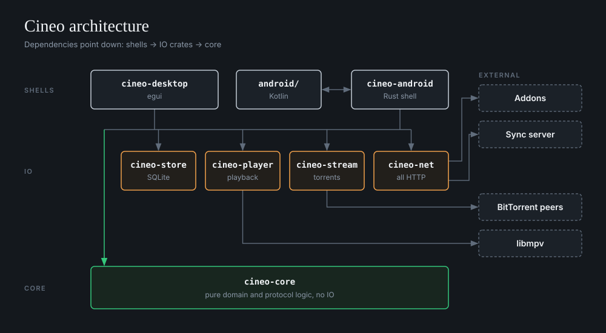
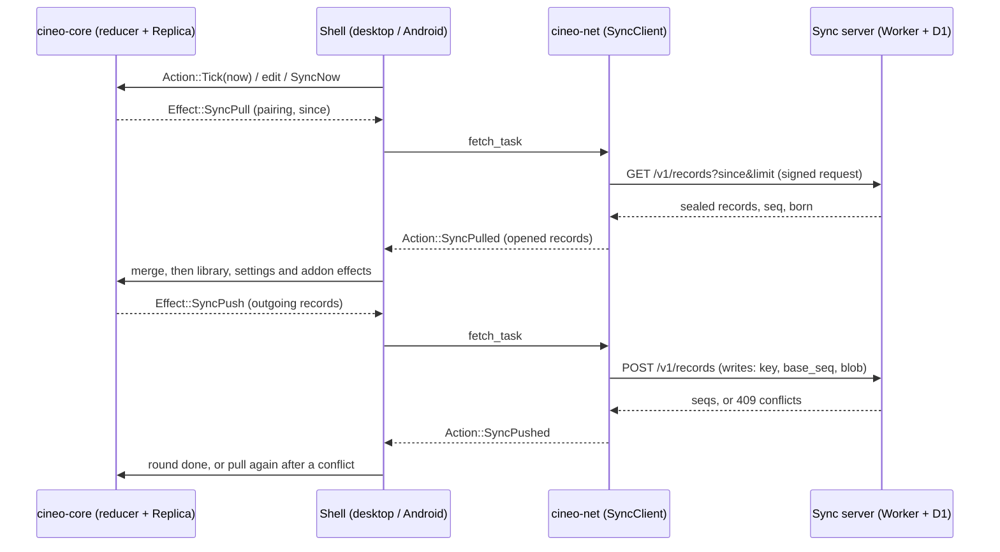
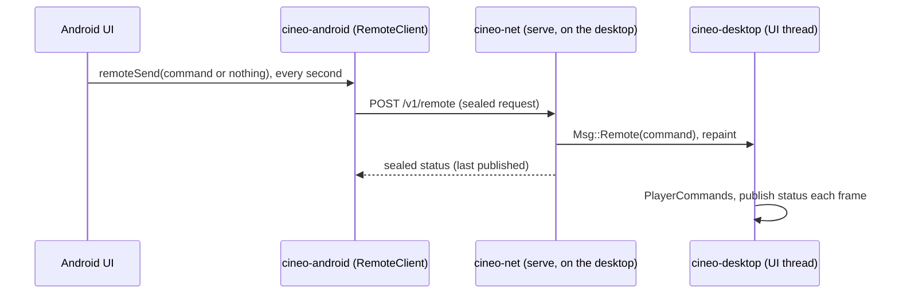
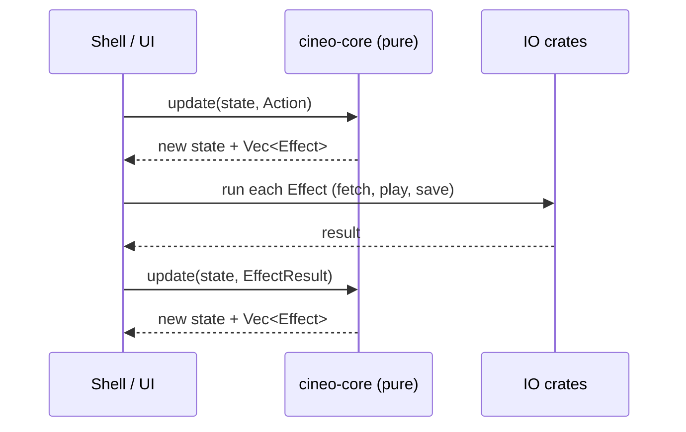

# Architecture

Decisions are recorded in [adr/](adr/README.md). Cineo runs on Linux
x86_64, Windows x86_64 and macOS arm64 and x86_64 (ADR-0022, ADR-0027,
ADR-0035). An Android port for
arm64, with a Kotlin UI over a Rust shell crate, is in progress
(ADR-0028); each release carries its APK (ADR-0029).

## System overview

Cineo follows a **functional core, imperative shell** design (ADR-0001):

- **`cineo-core`** is pure. It holds domain types, addon-protocol parsing and
  validation, request planning, and state reducers. It does no IO, has no
  async and no clock, so it can be tested exhaustively and quickly.
- **IO crates** perform effects described by the core. These are HTTP, the
  player (libmpv), storage and the streaming engine, and each has its own
  safety policy.
- **Shells** wire everything together and present state: the desktop GUI
  and the Android shell.

## Dependency direction

`shells → IO crates → core`. Never the reverse.

- `cineo-core` depends on no other workspace crate, no async runtime, no
  HTTP or UI library.
- IO crates depend on `cineo-core` and their own libraries (reqwest, rusqlite).
  They do not depend on each other.
- Only shells depend on several IO crates and decide policy, for example
  whether private networks are allowed.

## Crate boundaries (ADR-0002)

| Crate | Responsibility |
|-------|---------------|
| `cineo-core` | Protocol model (wire → domain), validation, filtering, URL building, aggregation, library/progress model, reducers |
| `cineo-net` | `AddonClient`: fetch with timeouts, size caps, SSRF-safe resolver and redirect policy; both ends of the remote control (ADR-0044) |
| `cineo-player` | Load libmpv at runtime, draw video into the window; typed commands, status and events (ADR-0014) |
| `cineo-store` | Persistence (installed addons, library, progress, settings) with migrations |
| `cineo-desktop` | GUI shell: eframe/egui, custom theme, images via `cineo-net` |
| `cineo-stream` | Local streaming engine: torrent sources → loopback HTTP URL (ADR-0010); `Torrents` runs the start, stop, status and lookahead steps for both shells |
| `cineo-android` | Rust half of the Android shell (ADR-0028): holds the core `State`, runs effects through the IO crates, and hands Kotlin `AppView` snapshots through UniFFI; the TLS verifier's JNI entry point |
| `cineo-sync-server` | The sync server (ADR-0043): request handling over SQL shared by SQLite and D1, and a native host for self-hosting. It depends only on `cineo-core`; the app uses it only in `cineo-android`'s tests |
| `cineo-uniffi-bindgen` | Only UniFFI's `uniffi-bindgen` binary, which Gradle runs to write the Kotlin bindings, so the Android build does not compile the app's Rust for the host too (ADR-0038) |

**When to add a crate:** only when the new code has a different dependency
set or a different IO boundary from an existing crate. A new *concept* is a
module, not a crate. The addon protocol stays a module of `cineo-core` until a
second consumer needs it standalone (for example an addon SDK).

## Boundaries

### Addon boundary

Addon data is untrusted. It is parsed in two steps (ADR-0003):

1. **Wire level, lenient.** JSON is walked field by field. A bad optional
   field becomes "absent" and produces a `Warning`. A bad array element is
   skipped with a `Warning`. Only missing required invariants (for example
   the manifest `id` or `version`) are errors.
2. **Domain level, strict.** The domain types (`Manifest`, `Resource`,
   `CatalogDef`, `MetaPreview`, …) carry invariants such as non-empty ids,
   `http(s)`-only image URLs and resolved inheritance. Code past the parser
   never re-validates.

Warnings are returned next to the value (`Parsed<T>`), and shells log them.
This keeps "the addon sent garbage" observable without failing the whole
response.

### Networking boundary

All HTTP goes through `cineo-net`'s `AddonClient`, which enforces `NetPolicy`
([SECURITY.md](SECURITY.md)). The core only builds `Url`s; it never fetches.
The update check is one more request through the same client: the core asks
for it with `Effect::CheckForUpdate` and compares the version it gets back.
Sync requests (`Effect::SyncPull`, `SyncPush`, `DeleteSyncSpace`) go
through the same client and policy too; see [Sync boundary](#sync-boundary-adr-0043).

### Player boundary (ADR-0014)

The core's `Effect::Play(PlayRequest)` starts playback. `cineo-player`
(`embedded::Player`) loads libmpv at runtime, and libmpv draws into the
desktop window through the OpenGL render API. The desktop shell draws the
video in an egui paint callback over the whole window and its own controls
on top (`cineo-desktop/src/player/`). The controls send typed
`PlayerCommand`s; a `Status` snapshot (position, pause, volume, tracks)
feeds them. Without libmpv, playback fails with a message saying so.
`cineo-player` looks for `libmpv.so.2` and `libmpv.so` in the executable's
directory first, then on the system library path.

mpv's events become `PlayerEvent`s (`Progress`, `Ended`, `Failed`,
`Closed`) through a small state machine (`tracker`), which the shell turns
into core actions. Shells never send raw mpv commands or options.
Untrusted strings never become mpv options.

### Persistence boundary

`cineo-store` stores domain values (installed addons with their order,
library items, progress). The core defines what is stored: the
`SaveAddons`, `SaveLibraryItem` and `DeleteLibraryItem` effects, which
`Store::apply` executes. The store defines how: one SQLite file, the schema
version in `PRAGMA user_version`, append-only migrations run in one
transaction, and a fixture per released schema (`tests/store/`). After
migrating, the file uses write-ahead logging with `synchronous = NORMAL`
(`file_databases_use_write_ahead_logging`): a commit does not wait for
an fsync, and a power loss can drop the last commits but not corrupt the
file.
The API is blocking; async shells call it off the runtime's worker threads.

### Sync boundary (ADR-0043)

Sync is optional and off by default. The desktop and Android turn it on in
Settings → Data. There are no accounts: a random 16-byte sync key, shown as
a 32-character code and a QR code, is the only credential, and everything
is encrypted on the device before it is sent.

#### On the wire

- **Server.** By default `https://cineo-sync.cineo-sync-server.workers.dev/`
  (`cineo_core::sync::DEFAULT_SERVER`), the Cloudflare Worker host on D1.
  Each pairing stores its server URL, so changing the setting only affects
  new pairings. It must be `https`, or `http` to this machine only
  (`server_allowed`, `parse_server`). Self-hosting: the native host behind
  a TLS proxy ([SYNC_SERVER.md](SYNC_SERVER.md)).
- **Routes.** `GET /v1/records?since=<seq>&limit=<n>` pulls pages of at
  most 2 MiB; `POST /v1/records` pushes at most 64 writes and 256 KiB per
  batch, each a record key, the version it replaces (`base_seq`) and a
  sealed blob of at most 32 KiB, and answers 409 with the server's
  versions when another device wrote first; `DELETE /v1/space` deletes the
  space after "Turn off and delete" or a key change. `GET /v1/info` exists
  for checks; the app does not call it. 410 means the space was deleted,
  429 and 503 mean busy (with `Retry-After`). A space holds at most 10,000
  records and 8 MiB.
- **What the server gets.** Each request is signed:
  `Authorization: Cineo-Ed25519 key=…, time=…, sig=…`, an Ed25519 signature
  over the method, the path from `v1/` on with its query, the time and the
  body's SHA-256. The key pair comes from the sync key through HKDF-SHA256;
  the server identifies the space by SHA-256 of the public key, verifies
  the signature and refuses a time more than 10 minutes off. A push that
  would create a space also needs `Cineo-Work`, a proof of work of 20 bits
  bound to the public key (about 0.5 to 0.9 s on a phone); without it the
  server answers 428 and the client works and retries once; record keys, the first 16 bytes of an HMAC of each record
  name; and blobs sealed with ChaCha20-Poly1305 under a key derived from
the sync key, with the format byte and record key as associated data, so a
blob cannot be moved to another record. It
  never sees titles, ids, progress, addon URLs or settings, but it sees the
  address, times and sizes of requests.

#### When devices connect

`Replica` decides, from the time the shell passes in:
- an edit goes out once a minute passes without further changes;
- progress goes out at most every five minutes while playing, and at once
  when playback stops;
- other devices' changes are pulled every ten minutes, and on "Sync now";
- once after start and then daily, a full check pushes again whatever the
  server lost (a restored backup or a swept space);
- after a failure the next round waits a minute, or the server's
  `Retry-After`; after a deleted space, sync pauses until the device is
  paired again.

The desktop ticks every second; Android ticks before each action and every
15 seconds, and also syncs when the app comes to the foreground. Nothing is
pushed on exit; waiting edits go out on the next start.

#### Pairing links

A device shows `cineo:///sync/<code>`, plus `?server=<url>` when its server
is not the default, as text and as a QR code (`pairing_link`). Opening the
link (`Route::Sync`), or scanning the QR code with Android's in-app
scanner, only fills the code and server in Settings → Data; nothing is
sent until "Pair" is pressed. Whoever holds the code can read everything
synced.

#### Modules

- `cineo_core::app` (built): `State::sync` holds the pairing, the replica
  and the round. `update` runs the reducer, then passes its persistence
  effects to the replica, starts a round when one is due, and saves the
  replica's changes (`Effect::SaveSync`). A round is a chain of
  `SyncPull` and `SyncPush` effects whose answers are merged into the live
  replica; what changed comes back as the usual library, settings and
  addon effects. The desktop sends `Action::Tick` every second and restores
  the pairing at start. Tests: `crates/cineo-core/tests/app_state/sync.rs`,
  against an in-memory server.
- `cineo-desktop` (built): `settings/sync.rs` shows the sync controls in
  Settings → Data, the code and its QR code (`pairing_link`, drawn with
  `qrcode`). Random keys and device ids come from the shell, which turns a
  `SyncRequest` into `EnableSync` or `RotateSyncKey`. The
  `cineo:///sync/<code>` link (`Route::Sync`) only fills the code. Tests:
  `crates/cineo-desktop/tests/ui/sync.rs`.
- `cineo-android` (built): `Cineo::sync_turn_on`, `sync_pair`,
  `sync_change_key`, `sync_now` and `sync_turn_off` check the code and
  server (`parse_code`, `parse_server`) and make keys before posting to the
  shell thread; `AppView::sync` carries the status, the code and the QR
  modules, which Compose draws. The shell restores the pairing at start,
  sends `Action::Tick` before every action and every 15 seconds, and
  syncs when the app comes to the foreground. Kotlin hands `cineo:` links
  from an intent filter to `sync_link`; the in-app scanner reads QR codes
  from CameraX frames with ZXing (`QrFrames`) and hands the text to the
  same `sync_link`. Tests:
  `crates/cineo-android/tests/shell/sync.rs`, against the native server.
- `cineo_core::sync` (built): `Stamp` and `Clock` (a hybrid logical
  clock), `Record` and its plaintext JSON, and `Replica`, which turns the
  persistence effects into records, merges remote records last writer wins
  per record (tombstones, a `library-cleared` marker, the union of addon
  lists when joining) and decides when to push and pull. Time and the
  device id are inputs. Settings in `DEVICE_LOCAL_SETTINGS` are never
  pushed or applied. Tests: `crates/cineo-core/tests/sync.rs`.
- `cineo-store` (built): the pairing (sync key, server URL, device id,
  clock and pull position) in `sync_pairing`, and each record with its
  server version and its unpushed and seeded flags in `sync_records`.
  `Replica::take_changes` hands over only what changed, so a progress save
  rewrites one row. Changes saved after `forget_sync` are dropped. Tests:
  the `sync` tests in `crates/cineo-store/tests/store.rs`.
- `cineo_net::sync` (built): the sync code (`format_code`, `parse_code`),
  `SpaceKeys` (HKDF-SHA256 to an Ed25519 signing key, an HMAC key for record names
  and a ChaCha20-Poly1305 key, all with `aws-lc-rs`), and `SyncClient`
  (`pull`, `push` in batches of at most 64 records and 256 KiB,
  `delete_space`, and `sync`, which pulls every page, pushes, retries
  after a conflict, and starts over when the server went back).
  HTTP goes through `AddonClient::send`, which applies
  `NetPolicy` and a body cap and returns the status, so 404, 409, 410 and
  503 become typed `SyncError`s. Tests: `crates/cineo-net/tests/sync.rs`.
- `cineo_core::sync::protocol` (built): the limits and the request and
  response bodies, used by both the client and the server.
- `crates/cineo-sync-server` (both hosts built; the Worker is deployed at
  `cineo-sync.cineo-sync-server.workers.dev`):
  `handler::handle` decides each answer (signature, proof of work, sizes, quotas, versions)
  over a crate-private `Db` trait that runs SQL statements and atomic
  batches, and asks a `Gate` before a push creates a new space (the
  native host's per-address limiter, or the Worker's `NEW_SPACES`
  binding). The SQL in `handler.rs` and `schema.sql` is meant for both
  SQLite and D1. The native host (`SqliteDb`, `serve`, the
  `cineo-sync-server` binary) uses hyper and rusqlite, limits requests
  per address (`RateLimiter`) and sweeps idle spaces every hour. It
  stores encrypted, opaque records and never sees plaintext. The Worker
  host (`worker_host.rs`, `cfg(target_arch = "wasm32")`) runs the same
  handler over D1, binding blobs as `Uint8Array`, and sweeps from a Cron
  Trigger; `scripts/check.sh` runs clippy on it for wasm32. Tests: unit
  tests in `src/handler/tests.rs` and `src/limit.rs`, and the client
  against the native host in `tests/end_to_end.rs`.

### Remote control boundary (ADR-0044)

The phone controls playback on a desktop on the same LAN. On by default
on the desktop: with nothing stored, `app::remote::at_start` makes a key
and dispatches `SetRemoteHost`; a turned-off listener is stored as a
`remote_host` row without a key and stays off.

- `cineo_core::remote` (built): `RemoteKey`, `Peer`, `is_lan` and
  `parse_address`; the closed `Command` set with checked ranges; `Request`
  and `Status` JSON; `Replays`, which refuses a request far from the clock
  or seen before. `State::remote` holds the desktop's key (`host`) and the
  phone's paired computer (`peer`); `SetRemoteHost` saves the key and asks
  for `Effect::ServeRemote`, `SetRemotePeer` saves the peer. Tests:
  `crates/cineo-core/tests/remote.rs`,
  `crates/cineo-core/tests/app_state/remote.rs`.
- `cineo_net::remote` (built): `RemoteKeys` (HKDF-SHA256 to a
  ChaCha20-Poly1305 key; requests and answers sealed with different
  associated data, the answer bound to the request's nonce); `serve`, a
  hyper HTTP/1 listener whose connections all close when the
  `RemoteServer` is dropped; `RemoteClient`, which posts through an
  `AddonClient` with private addresses allowed; the code and the
  `cineo:///remote/<code>?at=<address>` link; `lan_ip`. Tests:
  `crates/cineo-net/tests/remote.rs`.
- `cineo-store` (built): `remote_host` and `remote_peer`, one row each.
- `cineo-desktop` (built): `app/remote.rs` starts and stops the listener
  on `ServeRemote`, publishes what plays each frame, and turns each
  `Command` into `PlayerCommand`s on the UI thread, like media keys;
  speed and subtitle delay go through `Controls` so the desktop's menus
  agree. `settings/remote.rs` shows the switch, address, code and QR
  code. Tests: unit tests in `app/remote.rs`,
  `crates/cineo-desktop/tests/ui/remote.rs`.
- `cineo-android` (built): `Cineo::remote_pair`, `remote_forget` and the
  async `remote_send`, which runs on the shell's runtime; `AppView::remote`
  names the paired computer; `remote_link` reads scanned codes. Compose
  draws `RemoteSettings` and `RemoteScreen`. Tests:
  `crates/cineo-android/tests/shell/remote.rs`, against the real listener.

### UI boundary (ADR-0011)

The UI renders **state snapshots** and sends **actions**. It holds no business
logic. That keeps the GUI technology replaceable and lets the CLI exercise
exactly the same core paths.

In `cineo-desktop`:
- `view::show(ui, &State, &mut ViewState) -> Vec<Action>` is pure rendering.
  `ViewState` holds presentation only (open page, text being typed). The UI
  tests drive this function headlessly with `egui_kittest`.
- `app::CineoApp` is the shell. Before each frame it drains a channel of IO
  results and dispatches them. Fetches and playback run on a tokio runtime.
  Store writes go, in order, to one thread, which is joined on exit so the
  last progress write lands. Queued writes that a later one overwrites
  (settings, the addon list, a library item by id) are dropped
  (`queued_saves_keep_only_the_last_write_of_each_key`). mpv events become
  `PlaybackProgress` actions.
- Images: `images::NetImageLoader` (an egui `ImageLoader`) fetches through
  `cineo-net`, then decodes and downscales on the tokio blocking pool, at
  most one image per CPU core at a time. Downloaded images are kept in
  `<cache dir>/images` (`image_disk`), and textures past a budget are
  forgotten, least recently painted first.
- Text (ADR-0017, ADR-0021, ADR-0034): `build.rs` compiles the gettext
  catalogs `assets/i18n/*.po` with `fastframe-i18n`, and `i18n::t!` and
  `i18n::pt!` look the English text up in the thread-local locale. The locale is set from the
  `ui_language` setting every frame. Core returns `Problem` and `Notice` values, never prose.

### Platform integration

Linux, Windows and macOS (ADR-0022, ADR-0027, ADR-0035). Platform code
sits behind `cfg` in the crate that does the IO:

| Concern | Linux | Windows | macOS |
|---------|-------|---------|-------|
| Data and cache directories (desktop `dirs`, ADR-0034) | XDG state and cache via `fastframe-dirs` | `%LOCALAPPDATA%\Cineo\data`, `%LOCALAPPDATA%\Cineo\cache` via `fastframe-dirs` | `~/Library/Application Support/Cineo`, `~/Library/Caches/Cineo` via `fastframe-dirs` |
| Private files (`cineo-store`, `cineo-stream`, desktop subtitles) | mode 0700/0600 | the profile's default ACL | mode 0700/0600 |
| Torrent piece IO (`cineo-stream`) | `read_at`/`write_all_at` | `seek_read`/`seek_write` | `read_at`/`write_all_at` |
| libmpv (`cineo-player`) | system `libmpv.so.2` | `libmpv-2.dll` embedded in the release and written to the cache (`bundled-libmpv`) | dylibs in `Cineo.app/Contents/Frameworks`, else the system, `/opt/homebrew/lib` or `/usr/local/lib` |
| Single-instance handover (desktop `instance`, ADR-0032) | Unix socket via `fastframe-instance` | loopback port and token via `fastframe-instance` | Unix socket via `fastframe-instance` |
| Scheme registration (desktop `register`) | `xdg-mime` | `HKCU` via `reg.exe` | none (ADR-0035) |
| Self update (desktop `self_update`, ADR-0040, ADR-0041) | download, verify with minisign, swap the executable | download, verify with minisign, swap the executable and `licenses\` | none (update notice) |
| Media keys (desktop `media_keys`, ADR-0031) | MPRIS via `fastframe-now-playing` | SMTC via `fastframe-now-playing` | Now Playing via `fastframe-now-playing` |
| Keep awake (desktop `keep_awake`) | `org.freedesktop.ScreenSaver`, and idle sleep via `fastframe-power` | `SetThreadExecutionState` via `keepawake`, and idle sleep via `fastframe-power` | IOKit assertions via `keepawake`, and App Nap via `fastframe-power` |

`std::os::unix` and `std::os::windows` need a `cfg`.

On Android (ADR-0028) the UI is Kotlin and Compose in `android/`.
`cineo-android` runs `update` and the effects on its own `shell` thread,
the way `cineo-desktop` does on its UI thread, and after each batch of
messages hands Kotlin an `AppView` (only when it changed) through a
`StateListener` that Kotlin implements. Kotlin calls methods such as
`installAddon` that become `Action`s, and words the typed problems and
notices itself (ADR-0017). While the player or the torrent connecting
screen is up, the `AppView` leaves out the addons, catalogs, library and
detail those screens do not draw, so the torrent's status each second does
not carry them across. Images come through `Cineo.fetchImage`, so they
use `cineo-net` and its limits like every other request. The network
effects (`cineo_net::fetch_task`) and the store's writer thread
(`cineo_store::spawn_writer`) are shared with the desktop.

## State model and data flow

The state model follows the stremio-core idea of unidirectional flow, but
simplified (ADR-0001):

- `Effect` is a plain **enum (data)**, for example
  `FetchCatalog{addon, path}`, `SaveLibraryItem(LibraryItem)` or
  `Play(PlayRequest)`. Effects are not boxed futures, so reducers can be
  tested by asserting on returned effects.
- Request identity: each fetch effect carries the `ResourcePath`, and late
  responses for stale requests are dropped by comparing it.
- Implemented in `cineo_core::app`: `update(&mut State, Action) -> Vec<Effect>`.
  IO results come back as `*Loaded` actions keyed by `(addon, path)`.
  Detail meta falls back through candidate addons in user order. Stream
  groups fail independently.

## Async and concurrency model

- `cineo-core` is synchronous.
- IO crates and shells use **tokio** (multi-threaded runtime) with `Send`
  futures. WASM is not a target, so stremio-core's `ConditionalSend` split
  is not needed.
- Addon requests for one aggregation run concurrently, each with its own
  timeout. One addon failing or timing out never blocks the others: results
  arrive as partial updates.
- The player has one thread blocked in `mpv_wait_event`. It updates the
  `Status` snapshot and sends `PlayerEvent`s on a channel.

## Error model

- Libraries use `thiserror` enums with `#[non_exhaustive]`, one per failure
  domain (`ManifestError`, `FetchError`, …). Messages say what failed and
  where.
- Binaries (shells) use `anyhow` with `.context(...)` at each layer boundary.
- **Errors and logs never contain full addon URLs.** Addon paths often embed
  user configuration or API keys, so only the origin and the resource path
  are logged.
- `cineo-core` reports user-facing failures as typed `Problem` and `Notice`
  values; the desktop words them in the user's language (ADR-0017).
- Partial failure is normal. Aggregations return per-addon results, never one
  combined error.

## Observability

`tracing` spans exist per addon request (`req` id, addon origin, resource
path), per playback session and per startup phase. See
[DEVELOPMENT.md](DEVELOPMENT.md#debugging).

## Testing boundaries

See [DEVELOPMENT.md](DEVELOPMENT.md#testing):

- The core is tested with fixtures and pure assertions.
- IO crates are tested against local mocks (HTTP mock server, local
  torrent seeder, temporary SQLite); real-libmpv tests are opt-in.
- Shells get end-to-end tests: the CLI binary against a mock addon, the
  desktop views headlessly with `egui_kittest`, and the Android shell
  through its Rust API (`crates/cineo-android/tests/`).

## Deep links (ADR-0018)

`stremio://` and `cineo://` URLs parse into typed routes in the core
(`app::parse_link`). The desktop shell opens a link given on the command
line, hands it to an already running window (`instance.rs`), and registers
the schemes per user on request (`register.rs`). `cineo:///sync/<code>`
(`Route::Sync`) fills the sync code in Settings → Data
([Sync boundary](#sync-boundary-adr-0043)). Android has an intent filter
for the `cineo` scheme and acts only on sync links (`sync_link`).
